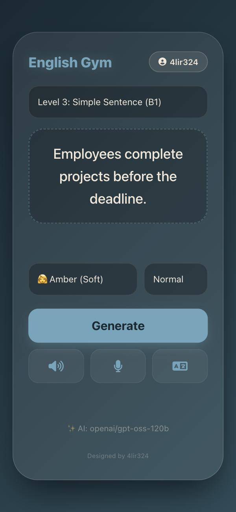

# AI English Gym

A small web app for practising English pronunciation. It writes a practice word or sentence for you, reads it aloud, listens to you say it, and scores your pronunciation word by word.

- **Text generation:** [Groq](https://groq.com) (open-weight chat models) creates the practice text and a Persian translation.
- **Speech:** [Azure AI Speech](https://learn.microsoft.com/azure/ai-services/speech-service/) reads the text aloud (neural voices) and runs **Pronunciation Assessment** on your recording, with a 0–100 score and per-word feedback.
- **Works on phones:** installable as a PWA, tested on iOS Safari.

<p align="center">
  
</p>

## Features

- Five difficulty levels, from a single word (A1) up to a C1-vocabulary sentence
- Text-to-speech with selectable voice and speed
- Microphone recording with an overall accuracy score and green/red highlighting per word
- One-tap Persian translation
- Multi-user: login with username and password, admin panel to add and remove users
- **API keys stay on the server.** Regular users never receive them; the browser only talks to this app's own API routes

## How it works

```
Browser ──▶ /api/groq          ──▶ Groq chat completions   (admin's Groq key, server side)
        ──▶ /api/azure/token   ──▶ Azure issueToken        (admin's Azure key, server side)
        ──▶ Azure Speech (WebSocket) using the short-lived (10 min) token
```

One admin owns the Groq and Azure keys and shares them with every user of the instance. Users are created by the admin; there is no public sign-up.

## Requirements

- Node.js 20.12 or newer
- A MongoDB database (local, Docker, or [Atlas](https://www.mongodb.com/atlas) free tier)
- A **Groq API key** — [console.groq.com](https://console.groq.com)
- An **Azure Speech resource** (key + region) — create one in the Azure portal; check the current free-tier limits before relying on it

## Getting started

```bash
git clone https://github.com/4lir324/english-gym-app.git
cd english-gym-app
npm install
cp .env.example .env.local
```

Edit `.env.local`:

| Variable | Description |
|---|---|
| `MONGODB_URI` | MongoDB connection string |
| `NEXTAUTH_SECRET` | Random secret for session cookies. Generate with `openssl rand -base64 32` |
| `NEXTAUTH_URL` | Public URL of the app (`http://localhost:3000` locally) |

Create the first admin account:

```bash
ADMIN_USERNAME=admin ADMIN_PASSWORD='choose-a-long-password' npm run create-admin
```

To change an existing user's password later (for example if you lost it), add `--reset`. The role and API keys are left untouched:

```bash
ADMIN_USERNAME=admin ADMIN_PASSWORD='a-new-long-password' npm run create-admin -- --reset
```

Tip: type the password with `read -s ADMIN_PASSWORD && export ADMIN_PASSWORD` first so it does not end up in your shell history.

Start the app:

```bash
npm run dev
```

Open http://localhost:3000, log in as the admin, open the profile chip at the top and save your **Groq key**, **Azure key** and **Azure region** (for example `eastus`, lower-case, no spaces). Then add users from the admin panel at `/admin`.

> The Groq and Azure keys are stored in the database (field `apiConfig` of the admin user), not in environment variables. Protect your database accordingly.

## Deployment

It is a standard Next.js app (`npm run build && npm start`) and runs on any Node host or on Vercel. Set the three environment variables above, make sure `NEXTAUTH_URL` matches your public **HTTPS** URL (browsers, and especially iOS, only allow microphone access over HTTPS), and run `npm run create-admin` once against the production database.

## Project structure

```
app/
  page.tsx                 main practice screen
  login/, admin/           login page and user management
  api/
    auth/[...nextauth]/    credentials login (NextAuth, JWT sessions)
    groq/                  server-side proxy to Groq
    azure/token/           issues short-lived Azure Speech tokens
    user/settings/         admin reads/saves the shared keys
    admin/users/           admin-only user management
lib/                       MongoDB connection, key lookup
models/User.ts             Mongoose user model
proxy.ts                   route protection (Next.js 16 proxy, formerly middleware)
scripts/create-admin.mjs   creates the first admin
```

## Known limitations

- No rate limiting on login or on the Groq proxy. If you expose an instance publicly, put it behind a rate limiter (Cloudflare, a reverse proxy, etc.).
- The `credits` field exists on users but is not enforced yet.
- Groq retires models regularly. The model list lives in `MODEL_QUEUE` in `app/page.tsx` and the allow-list in `app/api/groq/route.ts`; update both when a model disappears (`GET https://api.groq.com/openai/v1/models` shows what is active).
- Pronunciation scoring needs Azure. Google Gemini or Whisper can transcribe speech, but they do not return Azure-style phoneme scores.

## Contributing

Issues and pull requests are welcome. Please do not commit `.env.local` or any API key, and run `npx tsc --noEmit` before opening a PR.

## License

[MIT](LICENSE)

## Credits

Built with [Next.js](https://nextjs.org), [NextAuth.js](https://next-auth.js.org), [Mongoose](https://mongoosejs.com), the [Azure Speech SDK](https://www.npmjs.com/package/microsoft-cognitiveservices-speech-sdk) and [Groq](https://groq.com).
